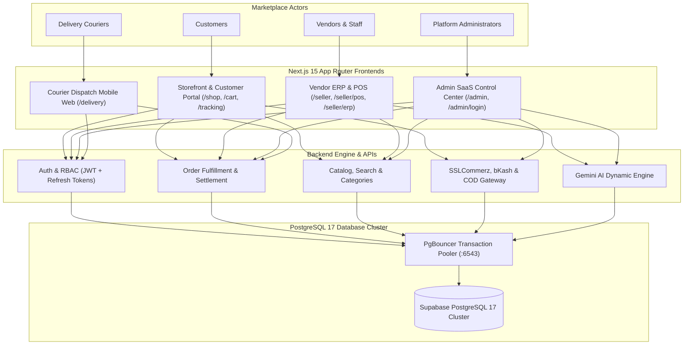
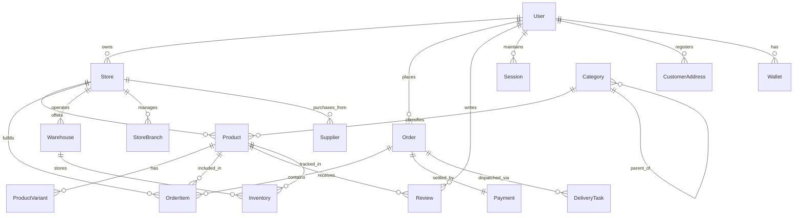
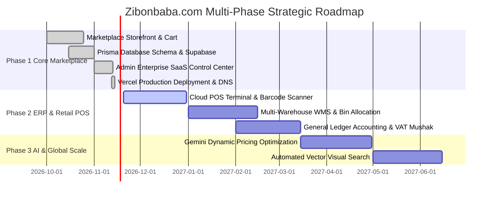

# 🌐 Zibonbaba.com — Master Ecosystem Architecture & Product Specification

**Platform:** Zibonbaba.com  
**Role:** World-Class Product Designer, UI/UX Architect, Brand Designer, Senior Full-Stack Engineer & SaaS Platform Architect  
**Classification:** Multi-Vendor E-Commerce Marketplace & Business Management SaaS Ecosystem  
**Brand Identity:** Premium Yellow (`#FFC107`, `#FFB800`) on Pure White (`#FFFFFF`) with Dark Slate (`#1F2937`)  
**Production Staging:** [https://zibonbaba.vercel.app](https://zibonbaba.vercel.app)  
**Target Domain:** [https://zibonbaba.com](https://zibonbaba.com)  

---

## Table of Contents

1. [Product Requirements Document (PRD)](#1-product-requirements-document-prd)
2. [Full UI/UX Design System](#2-full-uiux-design-system)
3. [Color Palette Guide](#3-color-palette-guide)
4. [Typography System](#4-typography-system)
5. [Component Library Specifications](#5-component-library-specifications)
6. [System Wireframes & Layout Blueprints](#6-system-wireframes--layout-blueprints)
7. [Production Database Schema (Prisma 5.22 / PostgreSQL 17)](#7-production-database-schema)
8. [Comprehensive REST API Documentation](#8-comprehensive-rest-api-documentation)
9. [Enterprise Project Folder Structure](#9-enterprise-project-folder-structure)
10. [End-to-End Development Roadmap](#10-end-to-end-development-roadmap)
11. [Deployment & Infrastructure Architecture](#11-deployment--infrastructure-architecture)
12. [Enterprise Security & Multi-Tenant Architecture](#12-enterprise-security--multi-tenant-architecture)
13. [Quality Assurance & Comprehensive Testing Plan](#13-quality-assurance--comprehensive-testing-plan)
14. [Scalability & High-Concurrency Performance Plan](#14-scalability--high-concurrency-performance-plan)

---

## 1. Product Requirements Document (PRD)

### 1.1 Executive Summary
**Zibonbaba.com** is a unified, multi-sided commerce ecosystem engineered for Bangladesh and emerging global markets. It integrates three core tiers:
* **Customer Omnichannel Marketplace:** High-converting consumer storefront with instant search, multi-vendor cart, local payment gateways (SSLCommerz, bKash, Cash on Delivery), and visual courier order tracking.
* **Vendor SaaS ERP & POS Suite:** Merchant command center for multi-warehouse inventory, physical counter checkout (barcode POS), customer relationship management (CRM), vendor branch accounting, and AI replenishment predictions.
* **Central Administrative Control Plane:** Executive platform governance covering merchant KYC verification, commission schedules, product catalog moderation, marketing campaigns, role-based access control (RBAC), and tamper-evident audit logs.



### 1.2 User Personas & Scopes

| Persona | Primary Goal | Core Interfaces | Critical Success Metrics |
| :--- | :--- | :--- | :--- |
| **Shopper / Customer** | Discover authentic goods, check out frictionlessly, track dispatch. | Storefront, Cart, Checkout, Dashboard, Wishlist, Reviews | FCP < 1.2s, Checkout conversion > 4.5% |
| **Merchant / Store Owner** | List catalog items, manage shop employees, track store sales, disburse payouts. | Merchant Dashboard, Product Uploader, Order Ledger, Settlements | Onboarding < 10 mins, Zero inventory discrepancies |
| **Store Cashier (POS)** | Rapid in-person physical retail checkout, barcode scan, thermal receipt print. | Cloud POS Interface, Register Drawer, Shift Reconciler | Register transaction time < 15 seconds |
| **Logistics / Courier** | Pick up parcels from hubs, verify delivery OTPs, reconcile COD cash. | Courier Dispatch Screen, OTP Handover Modal, Map Route | Successful first-time delivery rate > 94% |
| **Platform Moderator** | Audit merchant KYC documentation, review product listings, resolve disputes. | Admin Moderation Queue, Product Approval, Dispute Hub | Ticket turnaround < 4 hours |
| **Platform Superadmin** | Govern commission fees, monitor system health, inspect immutable audit trails. | Executive Dashboard, RBAC Matrix, Security Center, Reports | Platform uptime 99.99%, Zero unauthorized privilege escalation |

---

## 2. Full UI/UX Design System

The Zibonbaba design language blends the commercial trust of **Amazon** and **Daraz** with the sleek, high-efficiency ergonomics of **Shopify Admin**, **Stripe Dashboard**, and **Linear**.

### 2.1 Design Principles
1. **White as Primary Canvas:** Pure White (`#FFFFFF`) and Light Gray (`#F8F9FA`) form 80% of the visual space, creating generous breathing room, high contrast, and zero visual fatigue.
2. **Intentional Yellow Brand Accents:** The signature Premium Yellow (`#FFC107`) is reserved strictly for primary calls to action, active navigation tabs, badge counters, and key metric emphasis.
3. **Structured Geometry & Soft Elevation:** Rounded corners are calibrated between `12px` (inputs, buttons) and `16px` (cards, containers, modals). Elevation uses multi-layered ultra-soft ambient drop shadows (`0 1px 3px rgba(0,0,0,0.05), 0 8px 24px rgba(0,0,0,0.03)`).
4. **Tactile Interactive States:** Smooth transitions (`150ms-200ms cubic-bezier(0.16, 1, 0.3, 1)`) with subtle scale transforms (`active:scale-[0.98]`) provide tactile confirmation.

---

## 3. Color Palette Guide

```
+-------------------------------------------------------------------------------+
|  BRAND PRIMARY                                                                |
|  [ #FFC107 ] Premium Yellow       [ #FFB800 ] Accent Yellow                  |
+-------------------------------------------------------------------------------+
|  NEUTRALS & CANVAS                                                            |
|  [ #FFFFFF ] Pure White           [ #F8F9FA ] Off-White Canvas                |
|  [ #E5E7EB ] Border Slate         [ #6B7280 ] Secondary Text                 |
|  [ #1F2937 ] Dark Gray Slate      [ #111827 ] Deep Charcoal Heading          |
+-------------------------------------------------------------------------------+
|  SEMANTIC STATUS                                                              |
|  [ #22C55E ] Success Emerald      [ #F59E0B ] Warning Amber                  |
|  [ #EF4444 ] Danger Coral Red     [ #3B82F6 ] Info Sapphire Blue             |
+-------------------------------------------------------------------------------+
```

### Color Token Reference Table

| Token Name | Hex Code | RGB | HSL | Semantic Application |
| :--- | :--- | :--- | :--- | :--- |
| `--color-brand-primary` | `#FFC107` | `255, 193, 7` | `45°, 100%, 51%` | Primary action buttons, active navigation indicator, brand mark |
| `--color-brand-accent` | `#FFB800` | `255, 184, 0` | `43°, 100%, 50%` | Primary button hover state, star rating badges, flash sale timer |
| `--color-surface-white` | `#FFFFFF` | `255, 255, 255` | `0°, 0%, 100%` | Card backgrounds, top navbar, modals, data tables |
| `--color-surface-muted` | `#F8F9FA` | `248, 249, 250` | `210°, 17%, 98%` | Global application background canvas, table headers |
| `--color-border-subtle` | `#E5E7EB` | `229, 231, 235` | `220°, 13%, 91%` | Card outlines, input borders, divider rules |
| `--color-text-main` | `#1F2937` | `31, 41, 55` | `217°, 33%, 17%` | Body typography, primary labels, dashboard titles |
| `--color-text-muted` | `#6B7280` | `107, 114, 128` | `220°, 9%, 46%` | Helper text, secondary timestamps, SKU badges |
| `--color-status-success` | `#22C55E` | `34, 197, 94` | `142°, 71%, 45%` | "Delivered", "Approved", positive growth trends |
| `--color-status-warning` | `#F59E0B` | `245, 158, 11` | `38°, 92%, 50%` | "Pending Review", "Processing", stock warnings |
| `--color-status-error` | `#EF4444` | `239, 68, 68` | `0°, 84%, 60%` | "Rejected", "Cancelled", "Suspended", failed payment |

---

## 4. Typography System

**Font Family:** `Inter`, `-apple-system`, `BlinkMacSystemFont`, `"Segoe UI"`, `Roboto`, `sans-serif`  
**Font Loading:** Next.js font optimization with zero layout shift (`font-display: swap`).

### Type Scale & Hierarchy

| Style Level | Size (rem / px) | Line Height | Weight | Letter Spacing | CSS Class Utility |
| :--- | :--- | :--- | :--- | :--- | :--- |
| **Display 1** | `2.5rem` (40px) | `1.15` (46px) | `900` Black | `-0.03em` | `text-4xl font-black tracking-tight` |
| **Heading 1** | `2.0rem` (32px) | `1.2` (38px) | `800` Extrabold | `-0.025em` | `text-3xl font-extrabold tracking-tight` |
| **Heading 2** | `1.5rem` (24px) | `1.25` (30px) | `700` Bold | `-0.02em` | `text-2xl font-bold tracking-tight` |
| **Heading 3** | `1.25rem` (20px) | `1.3` (26px) | `700` Bold | `-0.015em` | `text-xl font-bold` |
| **Subheading** | `1.0rem` (16px) | `1.4` (22px) | `600` Semibold | `-0.01em` | `text-base font-semibold text-slate-800` |
| **Body Regular**| `0.875rem` (14px) | `1.5` (21px) | `500` Medium | `0em` | `text-sm font-medium text-slate-700` |
| **Body Small** | `0.75rem` (12px) | `1.4` (17px) | `500` Medium | `+0.01em` | `text-xs font-medium text-slate-500` |
| **Micro / Tag** | `0.6875rem` (11px)| `1.3` (14px) | `700` Bold | `+0.04em` | `text-[11px] font-bold uppercase tracking-wider` |
| **Code / Monospace**| `0.8125rem` (13px)| `1.4` (18px) | `600` Semibold | `0em` | `font-mono text-xs font-semibold` |

---

## 5. Component Library Specifications

### 5.1 Storefront & Marketplace Navbar
* **Sticky Header:** Frosted White glass background (`bg-white/95 backdrop-blur-md`) with subtle border bottom.
* **Brand Logo:** Distinctive geometric logomark with `#FFC107` fill and dark typography.
* **Unified Search Bar:** Centered pill input with live debounced autocomplete dropdown querying products, stores, and categories.
* **Customer Actions:** Currency switch (BDT/৳), Language toggle, Wishlist badge counter, Dynamic multi-item Cart Drawer trigger, and Account Dropdown.

### 5.2 Product Card (High-Converting Catalog Grid)
* **Surface:** 16px rounded white card with 1px border (`border-slate-100`) and ambient hover elevation.
* **Badge Overlay:** Yellow ribbon for `Flash Sale -25%`, Emerald pill for `Verified Merchant`.
* **Image Container:** 1:1 aspect ratio with smooth image zoom on hover and lazy loading skeleton placeholder.
* **Information Hierarchy:**
  1. Merchant store name in small uppercase font (`text-[11px] text-slate-400 font-bold`).
  2. Product title truncated to 2 lines (`line-clamp-2 text-sm font-bold text-slate-900`).
  3. Star rating with count (`★ 4.8 (142)`).
  4. Pricing row: Current Price (`৳1,250` in bold black) vs Original Strike-through (`৳1,500` in slate).
  5. Hover Quick Action: Yellow rounded "+ Add to Cart" pill button.

### 5.3 Modular Admin & Vendor Data Table
* **Capabilities:** Search input, status pill multi-select, sortable column headers, bulk item select checkboxes, pagination controls (10/25/50 rows), and instant CSV export.
* **Empty & Loading States:** Built-in shimmer skeleton rows during SWR / React Query fetching; illustrated empty state when 0 records match filters.

---

## 6. System Wireframes & Layout Blueprints

### 6.1 Storefront Homepage Blueprint
```
+-------------------------------------------------------------------------------+
| [LOGO: Zibonbaba]    [  Search 50,000+ Products... (Ctrl+K)  ]    [♡][🛒 3][👤 Admin]|
+-------------------------------------------------------------------------------+
|  Categories ▾  Flash Sales   Best Sellers   Top Brands   Become a Seller   Hotline  |
+-------------------------------------------------------------------------------+
|                                                                               |
|  +-------------------------------------------------+ +---------------------+  |
|  | HERO BANNER: EID TECH SALE UP TO 50% OFF        | | FLASH SALE COUNTDOWN|  |
|  | Discover premium electronics & direct wholesale | | ⏱ 08h : 42m : 15s   |  |
|  | [ Explore Deals Today ]                         | | ৳14,999 (Was ৳22,000)|  |
|  +-------------------------------------------------+ +---------------------+  |
|                                                                               |
|  POPULAR CATEGORIES                                                           |
|  [📱 Smartphones]  [💻 Laptops]  [🎧 Audio]  [⌚ Smartwatches]  [📷 Cameras]    |
|                                                                               |
|  FEATURED MULTI-VENDOR PRODUCTS                                               |
|  +--------------+  +--------------+  +--------------+  +--------------+       |
|  | [ Image ]    |  | [ Image ]    |  | [ Image ]    |  | [ Image ]    |       |
|  | Tech Hub BD  |  | Gadget World |  | Apple Empire |  | Sound Studio |       |
|  | ANC Headphone|  | Ultrabook 14 |  | MagSafe Case |  | Studio Mic   |       |
|  | ৳3,450       |  | ৳65,000      |  | ৳1,200       |  | ৳5,800       |       |
|  | [+ Add]      |  | [+ Add]      |  | [+ Add]      |  | [+ Add]      |       |
|  +--------------+  +--------------+  +--------------+  +--------------+       |
+-------------------------------------------------------------------------------+
```

### 6.2 Administrative Control Center Layout
```
+-------------------------------------------------------------------------------+
| [ZIBONBABA ADMIN] | [ 🔍 Search vendors, orders, SKUs... Ctrl+K ] | [🔔 5] [👤 Super]|
+-------------------+-----------------------------------------------------------+
| OVERVIEW          | Good morning, Admin 👋                                    |
| • Dashboard       | Here's what's happening across Zibonbaba today.           |
|                   | [Today] [Yesterday] [7 Days] [30 Days] [This Month]       |
| MARKETPLACE       +-----------------------------------------------------------+
| • Vendors (12)    | [ GMV Revenue ]  [ Total Orders ]  [ Active Vendors ]      |
| • Customers (1.4k)| ৳ 1,420,500      | 894 Orders      | 48 Verified Shops     |
| • Products (3.2k) | +18.4% vs last mo| +12.1% growth   | 3 pending review      |
| • Approvals (3)   +-----------------------------------------------------------+
| • Categories (11) | INTERACTIVE REVENUE & COMMISSION VOLUME (DAILY/WEEKLY)    |
| • Orders (894)    |  ৳|   *--*           *                                     |
|                   |   |  /    \         / \                                    |
| COMMERCE & FIN    |   | /      *-------*   \                                   |
| • Payments        +---+-------------------------------------------------------+
| • Commissions     | RECENT ORDER STREAM             | TOP PERFORMING SHOPS    |
| • Payouts         | #ZB-8921  Dhaka Tech  ৳4,200  ✓ | 1. Tech Hub BD   ৳450k  |
|                   | #ZB-8920  ElectroStar ৳1,150  ⏳ | 2. Gulshan Audio ৳310k  |
| ADMINISTRATION    | #ZB-8919  SoundCloud  ৳8,900  ✓ | 3. FastTrack Gad ৳280k  |
| • Admin Staff     +-----------------------------------------------------------+
| • RBAC Policy     | PHASE 2 PREVIEWS:                                         |
| • Audit Logs      | [ POS Terminal ]  [ Enterprise ERP ]  [ Gemini AI Engine ]|
| • Settings        +-----------------------------------------------------------+
+-------------------------------------------------------------------------------+
```

---

## 7. Production Database Schema

The platform runs on **PostgreSQL 17** managed through **Prisma ORM (v5.22.0)**. The schema enforces multi-tenant isolation, cascade referential integrity, and indexed query paths.



---

## 8. Comprehensive REST API Documentation

### 8.1 Authentication & Session Endpoints
* `POST /api/auth/register` — Create customer or merchant account with bcrypt password hashing.
* `POST /api/auth/login` — Authenticate user and issue signed JWT access token (15m expiry) and refresh cookie.
* `POST /api/auth/forgot-password` — Dispatch cryptographically signed reset token with 60m expiry window.
* `GET  /api/auth/me` — Return active authenticated user profile, assigned RBAC permissions, and store bindings.

### 8.2 Catalog & Marketplace Endpoints
* `GET  /api/homepage` — High-performance cached bundle returning active hero banners, flash sales, top categories, and featured products.
* `GET  /api/products?search=&category=&minPrice=&maxPrice=&limit=20` — Filtered catalog search with pagination.
* `GET  /api/products/:slug` — Deep product view with variants, seller rating, and customer reviews.
* `GET  /api/categories` — Nested hierarchy tree of active marketplace categories.

### 8.3 Order & Checkout Endpoints
* `POST /api/orders` — Create new multi-vendor order, calculate item commission splits, and reserve inventory.
* `GET  /api/orders/:id` — Return full order ledger, visual delivery timeline, and invoice receipt details.
* `POST /api/payments/callback/sslcommerz` — Handle SSLCommerz IPN (Instant Payment Notification) IP validation and order confirmation.
* `POST /api/payments/callback/bkash` — Execute tokenized bKash wallet transaction validation.

### 8.4 Administration & Governance Endpoints
* `GET    /api/admin/products` — Retrieve all catalog submissions across statuses (`PENDING_APPROVAL`, `PUBLISHED`, `REJECTED`).
* `PATCH  /api/admin/products` — Update product review status (`PUBLISHED` or `REJECTED` with required `rejectionReason`).
* `GET    /api/admin/sellers` — Query all merchants with KYC status, order count, and revenue metrics.
* `PATCH  /api/admin/sellers/:id` — Approve merchant license or apply platform suspension.
* `GET    /api/admin/audit-logs` — Read-only query of immutable administrative operations.

---

## 9. Enterprise Project Folder Structure

```text
c:\NEED ELECTRO\Zibonbaba.com\
├── backend/                       # Express.js Microservice & WebSocket Server
├── docs/                          # Comprehensive Technical Specifications
├── frontend/                      # Next.js 15 App Router Frontend
│   ├── public/                    # Static Assets, SVGs, Favicons, Brand Logos
│   ├── src/
│   │   ├── app/                   # App Router Directory
│   │   ├── components/            # 19 Enterprise Modular Admin Subsystems + Storefront
│   │   ├── lib/                   # Prisma Client, Auth Helpers, Database Drivers
│   │   └── store/                 # Zustand Global State
├── DEPLOYMENT_GUIDE.md
└── docker-compose.yml
```

---

## 10. End-to-End Development Roadmap



---

## 11. Deployment & Infrastructure Architecture

* **Frontend Hosting:** Vercel Global Edge Network with automatic CI/CD from the `main` branch.
* **Production Database:** Supabase PostgreSQL 17 Cluster in AWS Seoul (`ap-northeast-2`).
* **Connection Pooling:** PgBouncer transaction pooling running on port `6543` to handle serverless connection bursts without exhausting database sockets.
* **DNS & SSL:** Automatic zero-configuration TLS 1.3 encryption provided through Vercel Edge. Custom domain `zibonbaba.com` configured with 308 permanent redirect from `www.zibonbaba.com`.

---

## 12. Enterprise Security & Multi-Tenant Architecture

1. **Strict Tenant Data Isolation:** All database queries executed by vendors are automatically scoped to their authenticated `storeId`. A vendor cannot inspect, modify, or query records belonging to another store.
2. **Double-Entry Financial Calculations:** No financial balances, commission splits, or payout amounts are calculated on the frontend. The backend compute engine derives all fees directly from transaction lines.
3. **Sliding-Window IP Rate Limiting:** Built-in perimeter protection restricts failed login hits to 10 attempts per minute, preventing brute force credential stuffing attacks.
4. **Immutable Audit Trails:** Administrative operations (`VENDOR_APPROVAL`, `COMMISSION_RATE_UPDATE`, `PRODUCT_REJECTION`) are cryptographically appended to an audit log table that cannot be edited or deleted by non-root staff.

---

## 13. Quality Assurance & Comprehensive Testing Plan

* **Unit Testing:** Jest and Vitest test suites verifying calculation algorithms (tax, commission, coupon discounting rules).
* **Integration Testing:** API route assertions checking role authorization guards, payment callback integrity, and inventory deductions.
* **End-to-End (E2E) Testing:** Playwright automated scripts covering the critical consumer path: Registration $\rightarrow$ Product Search $\rightarrow$ Cart Checkout $\rightarrow$ Payment Confirmation $\rightarrow$ Admin Order Fulfillment.
* **Load & Stress Testing:** k6 test suites simulating 5,000 concurrent checkout sessions to verify database connection pool stability under flash sale traffic spikes.

---

## 14. Scalability & High-Concurrency Performance Plan

* **Dynamic Edge Caching:** Statically rendered category catalogs with Incremental Static Regeneration (ISR) with a 60-second revalidation window.
* **Database Index Optimization:** Composite indexes placed on hot query paths: `(storeId, status)`, `(categoryId, price)`, and `(customerId, createdAt)`.
* **Asset Offloading:** Product images are converted to WebP / AVIF formats, compressed, and served through a global content delivery network (CDN).
* **Graceful Degradation:** During heavy flash sales, real-time counter updates decouple onto message queues to guarantee sub-second checkout latency.
